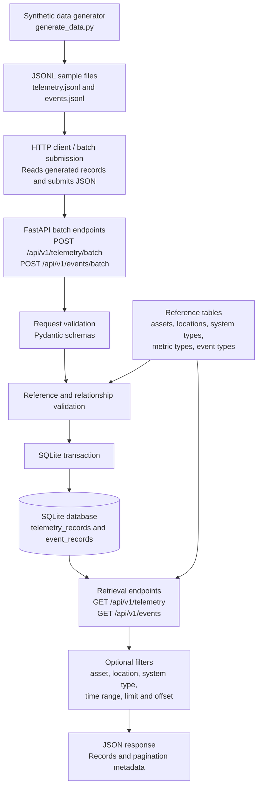
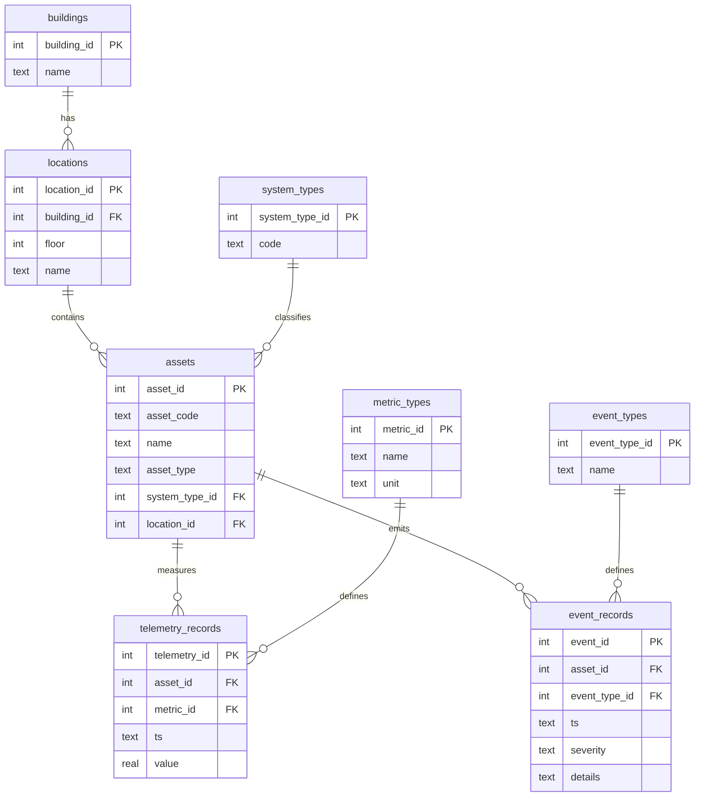

# Day 2 — Data Flow Diagram

## 1. Processing flow

The validation step checks that the asset, metric, and event type exist. Telemetry also checks that the asset type is allowed to emit that metric. It does not check that an event type belongs to the asset's system, and it does not check severity against the event type. The HTTP client in the diagram is not a file in this repository. The README section "Load a fresh database" is that step.

## 2. Database structure

How the tables relate. Boxes are tables. Arrows point from the child table to the parent table (foreign key direction).

### Relationships in plain language

| Parent | Child | Meaning |
|---|---|---|
| `buildings` | `locations` | Each location belongs to one building |
| `locations` | `assets` | Each asset is installed in one location |
| `system_types` | `assets` | Each asset belongs to one system (HVAC, CCTV, …) |
| `assets` | `telemetry_records` | Each measurement is for one asset |
| `metric_types` | `telemetry_records` | Each measurement uses one metric definition |
| `assets` | `event_records` | Each event is for one asset |
| `event_types` | `event_records` | Each event uses one event type definition |

### Keys and constraints

- Unique natural key on telemetry: `(asset_id, metric_id, ts)`
- Unique natural key on events: `(asset_id, event_type_id, ts)`
- `severity` must be `info`, `warning`, or `critical`
- `system_types.code` must be one of: `HVAC`, `NETWORKING`, `ACCESS_CONTROL`, `CCTV`, `FIRE_ALARM`
- Foreign keys are enforced when the application opens the connection (`PRAGMA foreign_keys = ON`)

### What is not stored as a relationship

- Which metrics an asset type may emit is a Python rule in `reference_data.py`, not a database table
- Event type is not linked to system type in the schema; the API does not block cross-system event names
